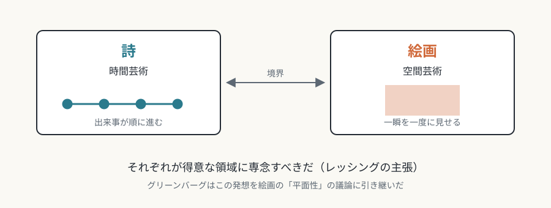
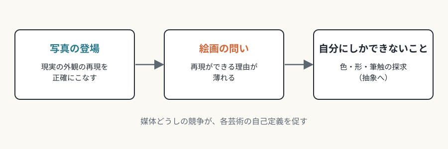

# 第1回　媒体固有性とは何か

## 芸術を「媒体の条件」から説明する理論の出発点

<!-- NAV:TOP -->
[連載目次](../README.md) | [第2回 →](02-architecture-and-sculpture.md)
<!-- /NAV -->

写真が登場したあと、絵画はなぜ抽象へ向かったのでしょうか。

写真は、現実の見た目を写し取る仕事を絵画より正確にこなしました。再現を奪われた絵画は、自分にしかできないことを探し始めた、とよく語られます。原因を一つに決められるわけではありませんが、その探索の先で、色、形、筆の跡が前面に出てきました。

この動きを理論として整理したものが、Medium Specificity（媒体固有性）です。

## 「何であるか」から「何でできているか」へ

媒体固有性とは、各芸術がその物質的・技術的な媒体に固有の特性を持ち、その特性を探ることが、その芸術ならではの表現を可能にするという美学理論です。

この理論は、問いの立て方を変えました。

- 従来の問い: 芸術とは何か（本質を問う）
- 媒体論的な問い: 各芸術は何によって成り立っているか（媒体を問う）

芸術の価値は、主題や内容では決まりません。媒体の特性をどれだけ自覚的に探っているかで決まる、というのが、この理論を代表するグリーンバーグの立場です。

## レッシングからグリーンバーグへ

起源をたどると、18世紀のレッシング『ラオコーン』に行き着きます。レッシングは、詩を時間芸術、絵画を空間芸術として分けました。そのうえで、それぞれが得意とする領域に専念すべきだと主張しました。[^lessing-laokoon]

*図1-1：ハゲサンドロス、アテノドロス、ポリュドロス《ラオコーン群像》（紀元前1世紀頃）。レッシングが論じた古代彫刻で、蛇に絞められる神官と息子たちを表す。撮影：Marie-Lan Nguyen。出典：[Wikimedia Commons](https://commons.wikimedia.org/wiki/File:Laocoon_Pio-Clementino_Inv1059-1064-1067.jpg)、パブリックドメイン。*

*図1-2：レッシングの区別：詩は時間の芸術、絵画は空間の芸術（本連載による概念図）。*

20世紀に、美術批評家のクレメント・グリーンバーグがこの議論を引き継ぎます。[^greenberg-newer-laocoon] グリーンバーグは、各芸術は他の芸術を真似るのではなく、自分の媒体の条件を純化し、自覚することで真正性を得ると考えました。のちに「モダニズムの絵画」（1960年）で、絵画に固有の条件は平面性だと論じました。[^greenberg-modernist-painting]

## 制約が創造を決める

この理論には逆説的な原理が含まれています。「何ができるか」だけでなく、「何ができないか」が創造性を決めるということです。

- 制約は障害ではなく、芸術家が解くべき問題として働く。
- その解き方の積み重ねが、様式の歴史になる。
- 媒体どうしの競争（写真と絵画のように）が、各芸術の自己定義を促す。

*図1-3：写真の登場と絵画の自己定義（本連載による概念図）。*

たとえば音楽は視覚的な要素を持てません。その不自由さが、音色や時間構造の洗練を押し進めた、と見ることもできます。「できない」ことは、表現の出発点になります。

## 現代での位置づけ

現代では、デジタル技術が従来の媒体の境界を溶かしています。画像も音も文字も映像も、コンピュータの中ではすべてデータです。そのため、媒体固有性という理論そのものの見直しが求められています（第10回で扱います）。

## この連載の読み方

次回から、九つの芸術を順に見ていきます。各回は次の三つの視点で進みます。

1. **媒体固有の条件**: その芸術は何に縛られているか
2. **固有の表現領域**: その縛りの中で何が可能になるか
3. **他芸術との境界**: 縛りを越えると何が起きるか

なお、建築と彫刻は境界の問題が互いに強く結びついているため、第2回でまとめて扱います。全体では、概念（第1回）、九つの芸術（第2〜9回）、現代的再考（第10回）という構成です。

## まとめ

- 媒体固有性は、芸術を「媒体の条件」から説明する理論である。
- 起源はレッシングの詩画論で、グリーンバーグがモダニズム批評として展開した。
- 「できないこと」という制約が、創造と様式史を形づくる。
- デジタル時代には、理論自体の再検討が必要になっている。

第2回では、重力に縛られる建築と、実体として眺められる彫刻を取り上げます。「住めるか、眺めるか」という違いが、二つの芸術を分けます。

## 参考文献・注記

[^lessing-laokoon]: ゴットホルト・エフライム・レッシング『ラオコオン——絵画と文学との限界について』（*Laokoon: oder über die Grenzen der Malerei und Poesie*、1766年。第1部のみ刊行）。邦訳は斎藤栄治訳（岩波文庫、1970年）。本文の「時間芸術」「空間芸術」という区別は、この議論の要約である。
[^greenberg-newer-laocoon]: クレメント・グリーンバーグ "Towards a Newer Laocoon"（*Partisan Review* 7巻4号、1940年7・8月）。邦訳「さらに新たなるラオコオンに向かって」は『グリーンバーグ批評選集』（勁草書房、2005年）に収められている。
[^greenberg-modernist-painting]: クレメント・グリーンバーグ「モダニズムの絵画」。1960年にヴォイス・オブ・アメリカのフォーラム講演として放送され、小冊子として刊行された。活字としては1961年の *Arts Yearbook* 4 に掲載された。邦訳は『グリーンバーグ批評選集』（勁草書房、2005年）に収められている。

<!-- NAV:BOTTOM -->
---

[連載目次](../README.md) | [第2回 →](02-architecture-and-sculpture.md)
<!-- /NAV -->
