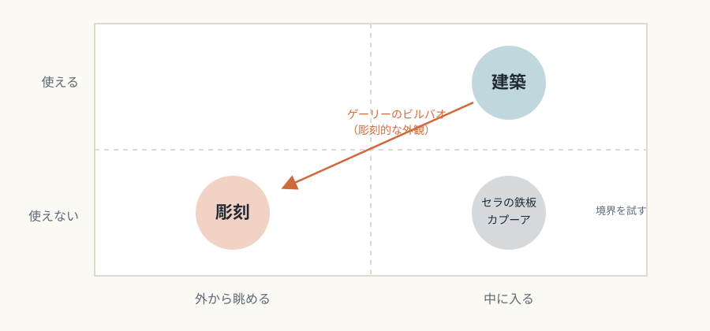
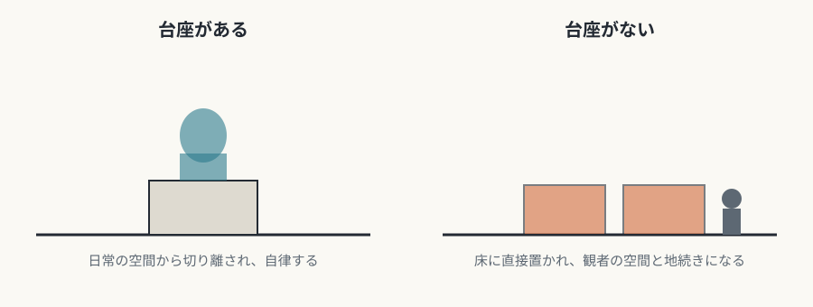

# 第2回　建築と彫刻——住めるか、眺めるか

## 重力と身体のスケールに縛られる建築、実体として眺められる彫刻

<!-- NAV:TOP -->
[← 第1回](01-what-is-medium-specificity.md) | [連載目次](../README.md) | [第3回 →](03-painting.md)
<!-- /NAV -->

建築と彫刻は、どちらも三次元の物質でできています。それでも二つを分ける決定的な違いがあります。中に入って使えるかどうかです。

## 建築

### 媒体固有の条件

建築は、重力・気候・地盤という自然法則に縛られる芸術です。設計とは、この拘束から逃れることではなく、拘束と対話することです。構造計算という工学的な合理性が美的な判断と切り離せないため、「構造的に不可能な美」は建築では成立しません。

もう一つの条件が、人間の身体のスケールです。天井の高さ、通路の幅、階段の蹴上げと踏面は、人体の寸法から導かれます。建築は眺める対象ではなく、入り込み、歩き、滞在する身体経験として受け取られます。この居住可能性（habitability）が、他の芸術との決定的な違いです。

人体基準からのずれは、意図的な効果として使われます。バロック建築の過剰なスケールも、茶室の極小の空間も、身体感覚を操作する手段です。

### 固有の表現領域

- **空間の分節と連続**: 動線は、身体の移動の順序を振り付けるものです。ル・コルビュジエの「建築的プロムナード」は、建築を静止した対象ではなく、時間軸に沿った経験として捉えました。[^le-corbusier-promenade] 日本建築の「奥」は、到達までの空間的な距離が心理的な価値を生むしくみを示しています。
- **光・影・素材と時間**: ルイス・カーンは、自然光のない部屋は部屋ではない、という趣旨のことを語りました。[^kahn-light] 経年変化（パティナ）を受け入れる素材選びは、時間の堆積を価値と見なす態度です。
- **機能と形態**: 「形態は機能に従う」というサリヴァンの命題は、機能が形を一つに決めるという誤解を生みました。[^sullivan-tall-office] 実際には、同じ機能に対して形の解は無数にあります。建築家は機能の要求と形への意志のあいだで判断しています。

重力への応答は、構造的な誠実さとして評価の基準になります。ゴシック大聖堂のフライングバットレスは、構造を外に出して内部空間を解放し、構造の表現と装飾が一致した典型例とされます。ザハ・ハディドらの設計は、デジタルの構造解析を使って、従来は難しかった形を実現した例として語られます。

*図2-1：ノートルダム大聖堂（パリ）の後陣と飛び梁（12世紀後半に起工、2011年撮影）。壁の外から石の梁で支える仕組みで、構造が外観に現れる。撮影：Jebulon。出典：[Wikimedia Commons](https://commons.wikimedia.org/wiki/File:Notre_Dame_chevet.jpg)、撮影者によるCC0（権利放棄）。*

## 彫刻

### 媒体固有の条件

彫刻は、現実の空間を占める三次元の実体です。観者と同じ物理空間にあるという事実が、絵画や映像との根本的な違いです。この存在感が、複製できない一回性を支えています。ブランクーシが台座と作品を一体にしたのは、「地面に立つ」という存在条件を主題にした行為だったと解釈されます。

彫刻は周りを歩いて見られることを前提とします。絵画が理想的な一つの視点を想定するのに対し、彫刻は360度のあらゆる角度からの視線を受け入れます。ジャコメッティの細長い人体像は、見る角度によって印象が変わり、多視点性を造形に取り込んだ作品として読めます。

素材の抵抗も表現と切り離せません。ミケランジェロは、優れた芸術家の構想はすでに一つの大理石の中にある、という趣旨のソネットを残しました。[^michelangelo-rime-151] 木彫は木目に沿うか逆らうかで表情が変わります。ブロンズ鋳造は、粘土の可塑性を金属の永続性に変換する技法で、素材の変換自体が表現にかかわります。

*図2-2：ミケランジェロ《反抗する奴隷》《瀕死の奴隷》（1513〜15年頃、ルーヴル美術館蔵）。粗い石の塊から人体が現れるように彫られている。撮影：Yair Haklai。出典：[Wikimedia Commons](https://commons.wikimedia.org/wiki/File:Michelangelo-Buonarroti-Slaves-Louvre.jpg)、パブリックドメイン。*

### 固有の表現領域

- **量塊（mass）と空虚（void）**: ヘンリー・ムーアは人体像に空洞を穿ち、量塊と空虚の対比を主題にしました。ヘップワースは、穴の向こうに背景が見える効果を探りました。形が切り取る負の空間も、彫刻の構成要素です。
- **触覚的な想像力**: 彫刻は視覚の芸術でありながら、「触りたくなる」衝動を呼びます。美術館の「触るな」という掲示は、その衝動が彫刻に本来備わっていることの裏返しとも読めます。

## 境界で起きること

### 建築と彫刻のあいだ

- リチャード・セラの巨大な鉄板の作品は、観者を空間に取り込みますが、住めないので彫刻にとどまります。
- アニッシュ・カプーアの《クラウド・ゲート》は下をくぐって歩けますが、使う機能がなく、二つの境界を試しています。
- フランク・ゲーリーのビルバオ・グッゲンハイムは、建築が視覚的なスペクタクルに傾いているという批判を受けました。[^foster-gehry] 建築が視覚的な対象に傾くと、居住性が犠牲になり、巨大な彫刻に近づきます。

ただし、この境界の侵犯が現代建築の実験の場にもなっています。固有性を純粋に守ることが、かえって創造を抑えることもあります。

*図2-3：建築と彫刻の境界：中に入れるか、使えるか（本連載による概念図）。*

### 台座の消失と「拡張された場」

伝統的な彫刻は、台座によって日常の空間から切り離され、作品としての自律性を保っていました。ミニマリズム（ドナルド・ジャッド、カール・アンドレ）は台座をなくし、作品を床に直接置いて、空間との関係を変えました。

*図2-4：台座のある彫刻と、台座のない彫刻（本連載による概念図）。*

ロザリンド・クラウスの「拡張された場における彫刻」は、彫刻概念の歴史的な変化を構造的に分析した論考です。[^krauss-expanded-field] 彫刻でないもの（風景や建築）との否定的な関係から彫刻を定義する試みは、本質を一つに決める見方を揺るがしました。ランド・アートやサイト・スペシフィック・アートは、媒体の概念そのものを問い直しています。

## まとめ

- 建築は、重力と身体のスケールに縛られ、居住可能性によって他の芸術と区別される。
- 彫刻は、実体としての存在、多視点性、素材の抵抗が条件で、量塊と空虚を操作する。
- 二つの境界は、内部に入って使えるかどうかにある。ただし、その境界を越える試みが現代の実験の場になっている。

第3回は絵画です。グリーンバーグ理論の中心にあった「平面性」を手がかりに、絵画が窓から壁へと再定義された経緯をたどります。

## 参考文献・注記

[^le-corbusier-promenade]: 「建築的プロムナード」は、ル・コルビュジエの作品集 *Œuvre complète*（ヴィリ・ボジガー編。現行版は Birkhäuser）に収められたサヴォア邸などの解説と結びつく語とされる。邦訳に、吉阪隆正訳『ル・コルビュジエ全作品集』（A.D.A. EDITA Tokyo、1977〜79年）がある。本文は趣旨の要約である。
[^kahn-light]: ルイス・カーンの1961年の講演 "Law and Rule in Architecture" に、どの空間にも自然光が必要だという趣旨の一節が引かれている（ペンシルベニア大学の展覧会 "Louis Kahn: The Making of a Room" のカタログによる）。本文は趣旨の要約であり、引用ではない。
[^sullivan-tall-office]: ルイス・H・サリヴァン "The Tall Office Building Artistically Considered"（*Lippincott's Magazine*、1896年）。原文は "form ever follows function" である。「機能が形を一つに決めるという誤解を生んだ」という整理は、本連載の解釈である。
[^michelangelo-rime-151]: ミケランジェロ『詩集』（*Rime*）151番（ジラルディ版の番号）のソネット "Non ha l'ottimo artista alcun concetto"。大理石の中の天使を解放した、という広く流布する言葉は、一次資料で確認できなかったため、本文では趣旨の言い換えにとどめた。
[^foster-gehry]: ハル・フォスター "Why all the hoopla?"（*London Review of Books* 23巻16号、2001年8月23日）。ゲーリーの建築を、スペクタクルとブランド化の観点から論じている。
[^krauss-expanded-field]: ロザリンド・クラウス "Sculpture in the Expanded Field"（*October* 8、1979年春）。この論考を媒体固有性を見直す流れの先駆けとして読むのは、本連載の解釈である。媒体固有性そのものへの直接の批判は、のちの「ポストメディウム」論に見られる（第10回）。

<!-- NAV:BOTTOM -->
---

[← 第1回](01-what-is-medium-specificity.md) | [連載目次](../README.md) | [第3回 →](03-painting.md)
<!-- /NAV -->
