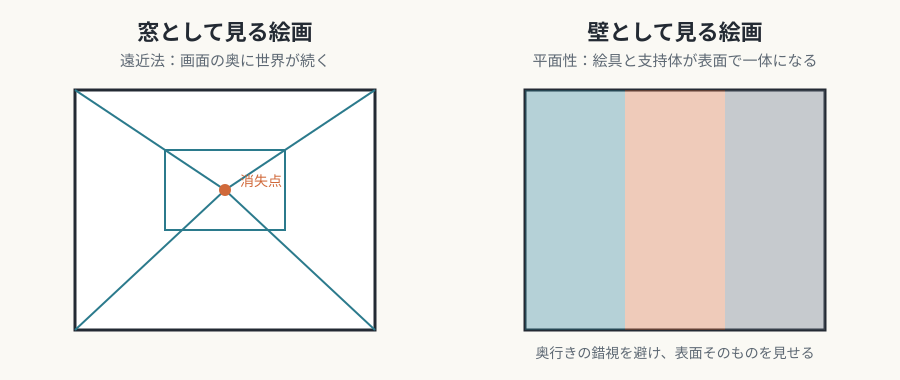

# 第3回　絵画——窓から壁へ

## 平面性、支持体と顔料、写真との競争が絵画を定義する

<!-- NAV:TOP -->
[← 第2回](02-architecture-and-sculpture.md) | [連載目次](../README.md) | [第4回 →](04-music.md)
<!-- /NAV -->

グリーンバーグの理論は、絵画を論じるために作られました。そのため絵画は、媒体固有性の考え方が最も鮮明に現れる芸術です。

## 媒体固有の条件

### 平面性（flatness）

絵画は本質的に二次元の平面です。奥行きの錯視は絵画に固有の能力ですが、グリーンバーグの理論では、絵画が克服すべき虚偽とも見なされました。[^greenberg-modernist-painting]

ルネサンス以来の遠近法は、絵画を「窓」として扱ってきました。[^alberti-de-pictura] 平面性の強調は、これを否定し、絵画を「壁」として定義し直す動きでした。モーリス・ルイスのステイン・ペインティングは、絵具を支持体に染み込ませ、表面と絵具を一体にしました。

*図3-1：絵画を「窓」として見る遠近法と、「壁」として見る平面性の違い（本連載による概念図）。*

### 支持体と顔料

キャンバスや板といった支持体の物質的な限界と、顔料の物理的な性質が、表現を決めます。

- 油彩は乾くのが遅く、重ね塗りやぼかしができます。フランドル派の繊細な光沢は、この性質に支えられていました。
- 水彩は即時的で、やり直しがききません。一回きりの筆致が求められ、油彩とはまったく違う制作態度になります。
- アクリル絵具は速く乾き、水に溶けます。ポップアートの平らな色面は、この技術的な基盤の上に成り立ちました。

### 枠（フレーム）

額縁は、絵画を壁から切り離し、内部に自律した視覚の秩序を作ります。フランク・ステラのシェイプト・キャンバスは、矩形を捨てて、枠と内部の形の関係を主題にしました。逆に、枠を消して壁画や環境芸術へ向かうことは、絵画の自律性と引き換えに空間との統合を選ぶ行為です。

## 固有の表現領域

### 奥行きの錯視

線遠近法、空気遠近法、色彩遠近法は、数世紀の探求が積み上げた知識体系で、他の芸術にはありません。トロンプ・ルイユ（だまし絵）は、平面でありながら三次元を装う矛盾を遊びにしました。キュビスムは、単一視点の遠近法を壊し、複数の視点を同時に示す空間を発明しました。

*図3-2：アルブレヒト・デューラー《リュートを描く男》（1525年頃）。遠近法の作図装置を使って、立体を平面に写し取る様子を描いた木版画。出典：[Wikimedia Commons](https://commons.wikimedia.org/wiki/File:D%C3%BCrer_-_Man_Drawing_a_Lute.jpg)、パブリックドメイン。*

### 色彩の並置と重なり

印象派の筆触分割は、網膜の上で色が混ざる効果を使い、絵具を混ぜては得られない輝きを出しました。ジョセフ・アルバースは、同じ色が周囲の色によって違って見えることを体系的に調べました。[^albers-interaction-of-color] ロスコの色面絵画は、色の境界をあいまいにして、色そのものの感情的・精神的な効果を主題にしました。

*図3-3：クロード・モネ《印象、日の出》（1872年）。印象派の名の由来となった作品。出典：[Wikimedia Commons](https://commons.wikimedia.org/wiki/File:Monet_-_Impression,_Sunrise.jpg)、パブリックドメイン。*

### 筆触（タッチ）

ファン・ゴッホの渦巻く筆致は、感情の激しさを見えるものにし、描く行為の身体性を前面に出しました。デ・クーニングの荒々しい筆致は、絵具を物質として強調しました。フォトリアリズムは、筆触の不在を技術的な達成として見せるという逆説を含んでいます。

*図3-4：フィンセント・ファン・ゴッホ《星月夜》（1889年）。夜空の渦が、うねる筆触でできていることが分かる。出典：[Wikimedia Commons](https://commons.wikimedia.org/wiki/File:Van_Gogh_-_Starry_Night_-_Google_Art_Project.jpg)、パブリックドメイン。*

## 他芸術との境界

### 写真との関係

写真は、現実の外観を写す力で絵画を上回りました。印象派以降の近代絵画史は、「写真にできないこと」を探る歴史として読むことができます。現代では、絵画が写真を模倣し（フォトリアリズム）、写真が絵画を模倣する（ピクトリアリズム）という、相互の参照も起きています。

### 純化の極限とその先

抽象表現主義は、媒体固有性の純化の極限と解釈されます。具象を完全に捨て、色、形、筆触という絵画の物質的な条件だけで画面を作る試みでした。ジャクソン・ポロックのドリッピングは、筆を介さず絵具を直接落とし、描く行為そのものを作り直しました。

ところが、この純化の論理は、ミニマリズムを経てコンセプチュアル・アートに至り、最終的には絵画の物質性そのものを否定する方向に行き着きました。純化を突き詰めた先で、媒体の枠が壊れたわけです。

## まとめ

- 絵画の固有条件は、平面性、支持体と顔料の性質、枠である。
- 錯視、色彩、筆触が、絵画に固有の表現領域をつくる。
- 写真との競争が自己定義を促し、純化の極限は絵画の枠そのものを揺るがした。

第4回は音楽です。空間的な持続を持たず、時間の中にだけ存在する芸術では、媒体の条件がどう表現を決めるのかを見ます。

## 参考文献・注記

[^greenberg-modernist-painting]: クレメント・グリーンバーグ「モダニズムの絵画」。1960年にヴォイス・オブ・アメリカのフォーラム講演として放送され、小冊子として刊行された。活字としては1961年の *Arts Yearbook* 4 に掲載された。邦訳は『グリーンバーグ批評選集』（勁草書房、2005年）に収められている。本文の「虚偽」という言い方は、この論考の趣旨を本連載がまとめたものである。
[^alberti-de-pictura]: レオン・バッティスタ・アルベルティ『絵画論』（*De pictura*、1435年）。画面に描いた矩形を「開かれた窓」と見なして描く、という説明が知られている。
[^albers-interaction-of-color]: ジョセフ・アルバース『色彩の相互作用』（*Interaction of Color*、Yale University Press、1963年）。邦題は『配色の設計』。

<!-- NAV:BOTTOM -->
---

[← 第2回](02-architecture-and-sculpture.md) | [連載目次](../README.md) | [第4回 →](04-music.md)
<!-- /NAV -->
