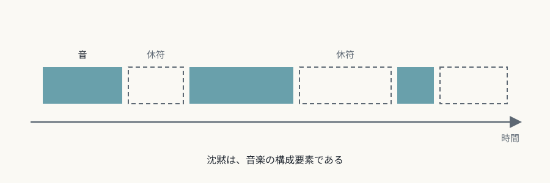
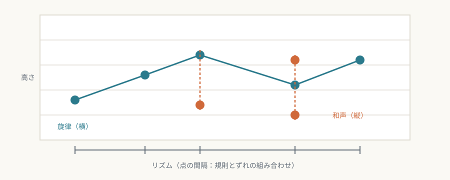

# 第4回　音楽——時間の中にしかないもの

## 時間の中にだけ存在し、沈黙と対比して意味を持つ芸術

<!-- NAV:TOP -->
[← 第3回](03-painting.md) | [連載目次](../README.md) | [第5回 →](05-literature.md)
<!-- /NAV -->

絵画は一瞬で全体を見渡せます。音楽は、時間をかけて順番に聴くしかありません。この違いが、音楽という芸術の出発点です。

## 媒体固有の条件

### 純粋な時間芸術

音楽は時間の中でだけ存在し、空間的な持続を持ちません。作品は演奏されている間だけ存在し、終われば消えます。録音技術は、この時間的な一回性を変えました。それでも「ライブ」の価値が保たれているところに、固有性が残っていると見ることができます。

### 音響という素材

音楽の素材は音響振動だけで、視覚的な要素を本質的に欠いています。周波数、振幅、波形という物理的なパラメータを組織するのが音楽であり、その数理的な関係が和声理論の土台になっています。

楽譜は音楽そのものではなく、演奏のための指示書です。絵画の習作や下絵とは、位置づけが根本から違います。ジョン・ケージの《4分33秒》は、演奏者が音を出さない三つの楽章を通して、会場の周囲の音を聴く場をつくり、音と音でないものの境界を問い直しました。[^cage-433]

*図4-1：ヴォルフガング・アマデウス・モーツァルト《ピアノ協奏曲第26番ニ長調 K.537》自筆譜の第1ページ（1788年）。楽器名と速度記号が書かれた、演奏のための指示書。モルガン図書館蔵。出典：[Wikimedia Commons](https://commons.wikimedia.org/wiki/File:Mozart_-_Piano_Concerto_No._26_K._537_-_autograph,_The_Morgan_Library_%26_Museum,_f._1r.jpg)、パブリックドメイン。*

### 沈黙との対比

音は、沈黙との対比によって意味を持ちます。休符は「音のない音楽」として積極的な意味を持ち、フレーズの間の休止が緊張と解放を生みます。アントン・ヴェーベルンの極端に短い曲は、沈黙の中に置かれた音の存在感を強く感じさせます。[^webern-brevity]

*図4-2：時間軸の上の音と休符（本連載による概念図）。*

## 固有の表現領域

### 旋律・和声・リズム

旋律は音高の時間的な連なりとして「横」の次元を、和声は音の同時的な重なりとして「縦」の次元をつくります。リズムは時間を区切り、規則とずれの組み合わせで推進力と緊張を生みます。三つの比重の置き方が、ジャンルの特徴になります。旋律を重んじるイタリア・オペラと、和声を重んじるドイツ音楽の違いは、しばしば対比される例です。

*図4-3：旋律・和声・リズムの三要素（本連載による概念図）。*

### 音色（timbre）

同じ高さの音でも、ヴァイオリンとフルートでは印象がまったく違います。ベルリオーズの『管弦楽法』（1843〜44年）以来、管弦楽は音色を設計の対象にしました。[^berlioz-instrumentation] 20世紀初頭にはシェーンベルクが、音色の連なりを旋律のように扱う「音色旋律」（Klangfarbenmelodie）を提案しました。[^schoenberg-klangfarbenmelodie] 電子音楽は、自然界にない音色を合成できるようにして、音色の幅を無限に広げました。

### 反復と変奏

ソナタ形式の主題の提示・展開・再現は、音楽の時間に建築のような構造を与えます。変奏曲は、同じ主題の変容を通して、同一性と差異の関係を時間軸の上に展開します。ミニマル・ミュージック（スティーヴ・ライヒ、フィリップ・グラス）は、微細な反復と少しずつの変化で、新しい時間感覚を作りました。

## 他芸術との境界

### 歌詞のある音楽

声楽曲では、言葉の意味と音楽の意味が競い合い、聴き手の注意が二つに分かれます。リート（ドイツ歌曲）は詩と音楽の理想的な融合を目指しましたが、その融合は、二つの媒体の固有性を互いに制限します。オペラの「音楽が先か、言葉が先か」という論争（プリマ・ラ・ムジカ対プリマ・レ・パローレ）は、媒体間の緊張を歴史の中で示しています。[^salieri-prima-la-musica]

### ワーグナーの総合芸術

ワーグナーは、音楽・詩・演劇・視覚芸術を統合して、個別の芸術を超えた経験を目指しました。[^wagner-kunstwerk-der-zukunft] この理念は、芸術の純化を説くグリーンバーグ的なモダニズムと反対の方向を向いています。[^greenberg-newer-laocoon] しかし、音楽が他の芸術を従わせる形になり、真の統合には至らなかった、という評価もあります。

*図4-4：ヨーゼフ・ホフマン《「ニーベルングの指環」舞台装置案「ラインの底」》（1876年、ヴィクトル・アンゲラー撮影）。ワーグナーが音楽と劇に視覚芸術を加えようとした舞台美術。出典：[Wikimedia Commons](https://commons.wikimedia.org/wiki/File:Victor_Angerer_-_Josef_Hoffmann%27s_%2801-14%29_Der_Rheingrund.jpg)、パブリックドメイン。*

## まとめ

- 音楽は時間の中にだけ存在する芸術で、素材は音響、沈黙も構成要素である。
- 旋律・和声・リズム、音色、反復と変奏が、固有の表現領域をつくる。
- 言葉や他の芸術と結びつくと、媒体どうしの緊張が生まれる。総合芸術は固有性を意図的に手放す試みだった。

第5回は文学です。感覚への直接の刺激を持たず、言語記号だけでできた芸術が、何を可能にしているのかを見ます。

## 参考文献・注記

[^cage-433]: ジョン・ケージ《4′33″》（1952年）。初演は1952年、ニューヨーク州ウッドストックのメイヴェリック・コンサートホール（ピアノ：デイヴィッド・テューダー）とされる。ケージの考えは、*Silence: Lectures and Writings*（Wesleyan University Press、1961年）に収められた文章などで読める。邦訳は柿沼敏江訳『サイレンス』（水声社、1996年）。
[^webern-brevity]: アントン・ヴェーベルン《管弦楽のための5つの小品》Op. 10の第4曲は6小節で約30秒（モルガン図書館の解説）。《弦楽四重奏のための6つのバガテル》Op. 9は全曲で5分に満たない（IRCAMの作品解説）。「沈黙の中に置かれた音の存在感」という言い方は、聴き手の受け取りとして書いた本連載の解釈である。
[^berlioz-instrumentation]: エクトル・ベルリオーズ *Grand traité d'instrumentation et d'orchestration modernes*, Op. 10（パリ、Schonenberger、1843/44年）。
[^schoenberg-klangfarbenmelodie]: アルノルト・シェーンベルク *Harmonielehre*（1911年）で提案された語とされる。実践の最初の例は、《5つの管弦楽曲》Op. 16の第3曲「色彩」とされる。
[^salieri-prima-la-musica]: アントニオ・サリエリ『まず音楽、それから言葉』（*Prima la musica e poi le parole*、台本ジョヴァンニ・バッティスタ・カスティ）。1786年2月7日にウィーンのシェーンブルン宮殿で初演されたとされ、この論争を題材にした作品として知られる。
[^wagner-kunstwerk-der-zukunft]: リヒャルト・ワーグナー *Das Kunstwerk der Zukunft*（ライプツィヒ、Otto Wigand）。1849年に書かれたとされる。刊行年は資料により1849年と1850年に分かれる。
[^greenberg-newer-laocoon]: クレメント・グリーンバーグ "Towards a Newer Laocoon"（*Partisan Review* 7巻4号、1940年7・8月）。この論考は、芸術の純粋さという発想を、音楽の例に結びつけて論じている。

<!-- NAV:BOTTOM -->
---

[← 第3回](03-painting.md) | [連載目次](../README.md) | [第5回 →](05-literature.md)
<!-- /NAV -->
