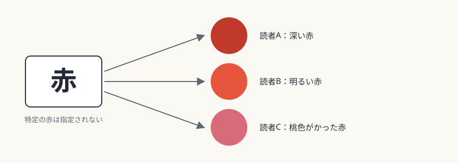
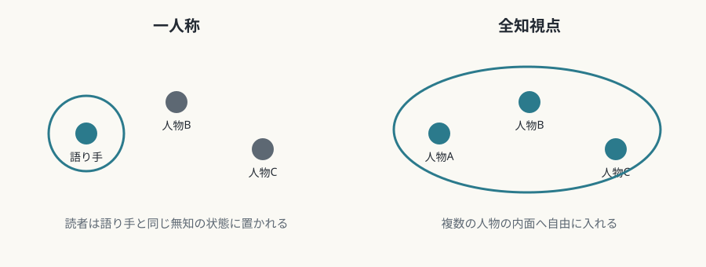

# 第5回　文学——言語だけでできた世界

## 言語記号だけで世界を立ち上げる芸術

<!-- NAV:TOP -->
[← 第4回](04-music.md) | [連載目次](../README.md) | [第6回 →](06-performing-arts.md)
<!-- /NAV -->

文学は、絵も音も直接には差し出しません。読者に渡されるのは言葉だけで、イメージは読者の想像力が作ります。一見すると弱みに見えるこの性質が、文学の強みでもあります。

## 媒体固有の条件

### 言語記号という唯一の媒体

文学は、感覚への直接の刺激を与えず、言語を介した間接的な表象で、読者の内的なイメージを呼び起こします。この間接性は、視覚芸術にはできない、抽象的な概念や内面の心理を直接書けるという強みでもあります。

「赤」という言葉は、特定の赤を指定しません。読者がそれぞれ違う赤を思い浮かべるところに、文学の普遍性とあいまいさがあります。

*図5-1：「赤」という一つの言葉と、読者ごとの異なる赤（本連載による概念図）。*

### 線形の時間軸

小説は、最初のページから最後のページへと順に読まれます。この時間的な強制が、物語のサスペンスを可能にします。読者は先のページをめくって結末を見ることもできますが、その「ズル」は文学体験を壊す行為として避けられます。コルタサルの『石蹴り遊び』のような実験的な小説は、二通りの読み順を示し、線形性そのものを問い直しています。[^cortazar-rayuela]

### 指示対象の不在

言語記号は、「ユニコーン」や「正義」のように、現実に存在しない対象や抽象概念も指し示せます。写真や絵画も存在しないものを描けますが、それは視覚的な虚構としてです。概念そのものを直接示すことはできません（この区別は本連載の見方です）。この抽象性のために、文学は哲学や思想と近く、論証的な働きを担いやすい芸術です。

## 固有の表現領域

### 内面意識の直接の描写

「彼は悲しんだ」という記述は、感情を直接名指しています。映画や演劇は、表情や動作、台詞や独白を通して間接的に示すことが中心です。ジョイスやウルフの意識の流れの技法は、思考の流れを写し取るかのように書き、心理描写を極限まで押し進めました。[^stream-of-consciousness] 信頼できない語り手は、語りの主観性そのものを主題にします。[^booth-rhetoric-of-fiction]

### 比喩・換喩・象徴

比喩は、異質な概念を結びつけ、既存の言語では言えなかった認識を生みます。象徴は、具体的な事物に多義的な意味を凝縮し、解釈の複数性を作品に抱え込ませます。これらは言語芸術に固有の技術体系で、長い蓄積があります。

### 語りの視点

一人称は、語り手の認識の範囲に情報を限り、読者は語り手と同じ無知の状態に置かれます。全知視点は、複数の人物の内面に自由に入り込み、俯瞰的な把握を可能にします。自由間接話法は、語り手の声と登場人物の声を溶け合わせ、視点の帰属をあいまいにする高度な技法です。

*図5-2：語りの視点ごとに、読者が知れる範囲（本連載による概念図）。*

## 他芸術との境界

### 朗読と演劇化

朗読は、声の調子、速さ、抑揚という音響的な要素を加えます。戯曲の上演は、俳優の身体、舞台空間、照明などの言語以外の要素によって、テクストを超えた複合的な体験になります。このとき言語テクストは素材の一つに降格し、文学に固有の抽象性や想像を呼ぶ力は弱まります。

### 視覚詩・具体詩

マラルメの『骰子一擲』は、活字の配置を意味の生成に関与させ、ページの視覚的な構成を詩の要素にしました。[^mallarme-un-coup-de-des] 具体詩は、言語を視覚的な素材として扱い、読むことと見ることを同時に体験させます。これらは言語の純粋性を侵しますが、同時に、言語に物質性という隠れた次元があることを見せます。

*図5-3：ステファヌ・マラルメ《骰子一擲》（1914年刊の初の単行本版より）。語句のあいだに大きな余白をとり、活字の位置そのものを詩の一部にしている。出典：[Wikimedia Commons](https://commons.wikimedia.org/wiki/File:Mallarm%C3%A9_-_Un_coup_de_d%C3%A9s_1914_-_p6.jpg)、パブリックドメイン。*

## まとめ

- 文学は、言語記号だけを媒体とし、イメージを読者の想像にゆだねる。
- 内面の描写、修辞、語りの視点が、他の芸術にない固有の領域になる。
- 上演化や視覚化は、言語の自律性を手放す代わりに、新しい次元を開く。

第6回は舞台芸術です。生身の身体と観客が同じ空間にいるという条件が、何を生み、何を縛るのかを見ます。

## 参考文献・注記

[^mallarme-un-coup-de-des]: ステファヌ・マラルメ『骰子一擲』（*Un coup de dés jamais n'abolira le hasard*）。1897年に雑誌 *Cosmopolis* に掲載された。マラルメの生前に意図どおりの書籍版は刊行されず、最初の単行本は1914年に出た。この1914年版の活字や判型は、本人の意図とは異なるとされる。邦訳に、秋山澄夫訳『骰子一擲』（思潮社、1984年）がある。
[^cortazar-rayuela]: フリオ・コルタサル『石蹴り遊び』（*Rayuela*、Editorial Sudamericana、1963年）。作者が二通りの読み順を示している。邦訳は、土岐恒二訳が『世界の文学29 コルターサル』（集英社、1978年）に収められている。
[^booth-rhetoric-of-fiction]: ウェイン・C・ブース *The Rhetoric of Fiction*（University of Chicago Press、1961年）。「信頼できない語り手」という語を提唱したとされる。ブースの定義は、語り手が作品の規範に沿って語っているかどうかに関わる。本文の「語りの主観性そのものを主題にする」という言い方は、本連載の解釈である。
[^stream-of-consciousness]: 「意識の流れ」という語は、ウィリアム・ジェイムズ『心理学原理』（*The Principles of Psychology*、1890年）に由来するとされる。文学の代表例に、ジェイムズ・ジョイス『ユリシーズ』（1922年）、ヴァージニア・ウルフ『ダロウェイ夫人』（*Mrs Dalloway*、Hogarth Press、1925年）がある。

<!-- NAV:BOTTOM -->
---

[← 第4回](04-music.md) | [連載目次](../README.md) | [第6回 →](06-performing-arts.md)
<!-- /NAV -->
