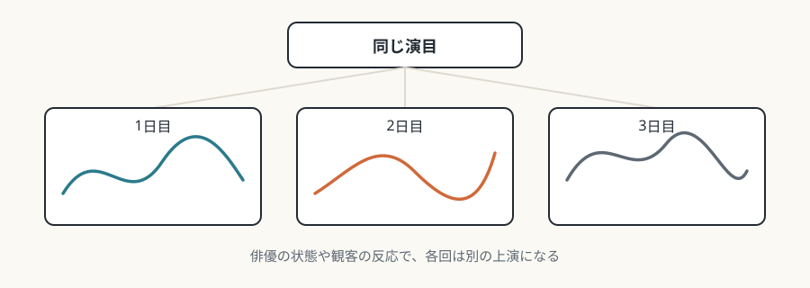
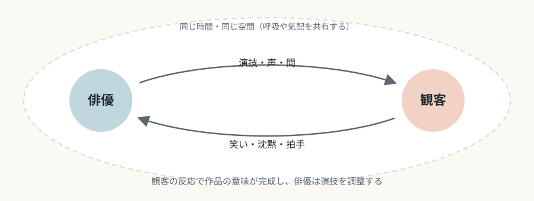

# 第6回　舞台芸術——今ここに身体がある

## 身体の現前と一回性が、舞台芸術を他の媒体から分ける

<!-- NAV:TOP -->
[← 第5回](05-literature.md) | [連載目次](../README.md) | [第7回 →](07-cinema.md)
<!-- /NAV -->

演劇や舞踊は、録画しても同じ作品にはなりません。舞台芸術の条件は、生身の身体と観客が、同じ時間に同じ場所にいることです。

## 媒体固有の条件

### 身体の現前と空間の共有

俳優と観客は同じ物理空間にいて、呼吸、体温、気配を共有します。この身体的な共在の感覚が、舞台芸術の「オーラ」を形づくります。[^benjamin-aura] COVID-19の流行中にオンライン上演が広がったことで、共在の有無が体験を大きく左右することが、改めて意識されました。

### 一回性

同じ演目の連続公演でも、各回は別の上演です。俳優のコンディションや観客の反応で、上演は変わります。この一回性が舞台の緊張感と特別さを生み、「今夜限り」という体験の価値を支えます。[^phelan-auslander] 失敗や事故、ハプニングの危険も一回性の帰結で、その危険が生の迫力を保証しています。

*図6-1：同じ演目でも、上演は毎回違う（本連載による概念図）。*

### 上演時間と現実時間の一致

映画は、時間を圧縮し、引き延ばし、逆行させます。演劇の上演時間は、現実の時間として不可逆に進みます。場面転換のための中断が必要になり、幕間という慣習が生まれた面があります。リアルタイムで進むという制約は、場所と時間の統一という古典主義の規則が、根拠の一つとして論じられる背景になりました。[^three-unities]

## 固有の表現領域

### 身体・声・動作による意味の生成

俳優の身体は、意味を伝える媒体であり、それ自体が鑑賞される対象でもあります。声の質、抑揚、間、呼吸は、台詞の意味を超えた情動的な効果を生み、訓練の対象になります。舞踊の動作は、言語的な意味を持たないまま感情や観念を直接伝え、身体表現の自律性を示します。

### 観客との相互作用

喜劇での笑いのタイミングや、悲劇での沈黙の重さは、観客の反応によって作品の意味が完成していく過程です。俳優は観客の反応をその場で感じ取り、演技を調整します。観客参加型の演劇は、この相互作用を主題にして、観客と演者の境界をわざと乱します。

*図6-2：俳優と観客の相互作用（本連載による概念図）。*

### 複数の身体の配置と移動

ミザンセーヌ（舞台構成）は、舞台上の人物の配置で、権力関係や心理的な距離を見えるものにします。群衆の場面での身体の組織化は、振付に近い面を持ち、演出家の視覚的な構想力を求めます。前景・中景・後景や上手・下手といった空間の使い方は、数世紀の慣習によるコードになっています。

## 他芸術との境界

### 映像記録

舞台の中継や収録映像は、舞台体験の代わりにはならず、別の種類のメディア体験です。カメラアングルの選択は、観客の自由な視線を奪い、演出家ではなく映像監督の解釈を押しつけます。ただし、NTライブのような質の高い中継は、「ないよりまし」を超えて、アクセスのしやすさを広げています。[^nt-live-phedre]

### ハプニングとパフォーマンスアート

1950年代末に始まり1960年代に広まったハプニングでは、美術家が生身の身体を素材に使い、美術と演劇の境界が溶けました。[^kaprow-happenings] マリーナ・アブラモヴィッチのパフォーマンスは、演劇的な虚構を拒み、現実の行為として続きます。[^abramovic-performances] この領域では、舞台芸術の「役を演じる」という虚構性が放棄され、行為者と人格が一致していると主張されます。

## まとめ

- 舞台芸術の条件は、身体の現前、一回性、上演時間と現実時間の一致である。
- 身体表現と観客との相互作用が、作品を共同で作り上げる。
- 映像化は別のメディア体験であり、パフォーマンスアートは虚構性を手放すことで境界を乱す。

第7回は映画です。舞台とは対照的に、時間を自由に操作できるこの媒体の文法を、モンタージュを中心に見ていきます。

## 参考文献・注記

[^benjamin-aura]: ヴァルター・ベンヤミン「複製技術時代の芸術作品」。邦訳に、浅井健二郎編訳『ベンヤミン・コレクション1 近代の意味』（ちくま学芸文庫、1995年）所収のものがある。ここでの「オーラ」は、ベンヤミンの用語を借りた本連載の用法である。
[^phelan-auslander]: ペギー・フェラン *Unmarked: The Politics of Performance*（Routledge、1993年）は、パフォーマンスの生は現在にあり、消えていくものだとする。フィリップ・アウスランダー *Liveness: Performance in a Mediatized Culture*（Routledge、1999年）は、生と録画を対立させる見方を批判する。舞台の一回性と録画の関係を考える手がかりになる。
[^three-unities]: 三一致（行為・時間・場所の統一）は、アリストテレス『詩学』を根拠にルネサンス期に定式化された規則とされる。場所の一致は、アリストテレス自身は述べていないと説明される。ロドヴィコ・カステルヴェトロ『アリストテレス詩学の俗語訳と解説』（*Poetica d'Aristotele vulgarizzata e sposta*、1570年）が定式化したとされる。
[^nt-live-phedre]: ナショナル・シアター・ライヴは、2009年6月25日の『フェードル』（ヘレン・ミレン主演、ニコラス・ハイトナー演出）で始まった。観客数などの数字は、資料によって異なるため載せない。
[^kaprow-happenings]: アラン・カプロー *18 Happenings in 6 Parts*（Reuben Gallery、ニューヨーク、1959年10月）が、ハプニングの先駆けとして知られる。
[^abramovic-performances]: マリーナ・アブラモヴィッチ *Rhythm 0*（1974年、ナポリ）、*The Artist Is Present*（ニューヨーク近代美術館、2010年3〜5月）。本文の「虚構を拒み」は、本人の発言を踏まえた本連載の要約である。

<!-- NAV:BOTTOM -->
---

[← 第5回](05-literature.md) | [連載目次](../README.md) | [第7回 →](07-cinema.md)
<!-- /NAV -->
