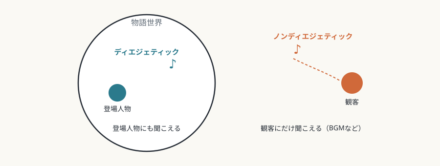

# 第7回　映画——編集がつくる時間

## モンタージュと運動の錯視が、映画の文法をつくる

<!-- NAV:TOP -->
[← 第6回](06-performing-arts.md) | [連載目次](../README.md) | [第8回 →](08-photography.md)
<!-- /NAV -->

舞台の時間は、現実の時間として進みます。映画の時間は、切って、つないで、作ります。この差が、映画という媒体の核心です。

## 媒体固有の条件

### モンタージュ（編集）

モンタージュは、別々の時間と場所で撮ったショットをつなぎ、現実にはない連続性を作ります。エイゼンシュテインは衝突モンタージュの理論を展開し、異質なショットがぶつかることから概念が生まれると主張しました。[^eisenstein-film-form] クレショフ効果は、同じ顔のショットが前後の文脈によって違う感情を帯びて見えると伝えられる実験です。元の映像は失われており、後年の追試も結果が分かれていますが、文脈が表情の読みに影響することは示されています。[^kuleshov-effect]

*図7-1：同じ顔のショットが、つなぐショットで違う意味を帯びる（クレショフ効果の模式図。伝えられる実験の再現ではない）。*

### 運動の錯視

映画の運動は錯視です。実際には、静止画が高速で切り替わっているだけです。この技術的な基盤が、映画と現実の存在論的な違いを決め、映画の時間を、現実の時間の変形として成り立たせています。高フレームレート（48fpsなど）への移行が、映画らしさが失われるものとして抵抗を受けることがあるのは、技術的な制約が美学として根づいていることの表れと読めます。[^hfr-the-hobbit]

*図7-2：エドワード・マイブリッジ《疾走するサリー・ガードナー》（1878年）。疾走する馬を連続写真で分解して見せたカード。映画の前史の一つとして語られる。出典：[Wikimedia Commons](https://commons.wikimedia.org/wiki/File:Eadweard_Muybridge-Sallie_Gardner_1878.jpg)、パブリックドメイン。*

### 視聴覚の同期

映画の音声は、映像とは別の素材として編集・加工でき、両者の同期は技術的に作られたものです。フォーリー（効果音の後付け制作）は、現実の音を誇張したり置き換えたりして、現実を超えた音響空間を設計します。音と映像の対応をあえて崩す技法（非同期音響）は、媒体の技術的な前提を見せる働きをする、と読めます。

## 固有の表現領域

### ショットサイズ・カメラ移動・アングル

クローズアップは、顔の微細な表情の変化を捉え、舞台ではできない心理的な接近を実現します。主観ショットは、登場人物の視点を観客に強いる、感情移入の装置です。トラッキング、クレーン、ステディカムなどのカメラ移動は、空間を動的に探り、観客を空間の中へ引き込みます。

### クロスカッティング

別々の場所で同時に進む行動を交互に見せることで、映画に固有の同時性の表現が成り立ちます。グリフィスの『イントレランス』は、四つの時代を並行して編集し、歴史を横断する主題の統一を見えるものにしました。[^griffith-intolerance] サスペンス映画の「ラストミニッツ・レスキュー」は、クロスカッティングで緊張を築く典型です。

*図7-3：D・W・グリフィス監督『イントレランス』（1916年）、バビロン編のセットのスチル。四つの時代の物語を並行して編集した作品の一場面で、編集そのものではなくセットを示す。出典：[Wikimedia Commons](https://commons.wikimedia.org/wiki/File:Griffith_intolerance.jpg)、パブリックドメイン。*

### 物語世界の内と外の音響設計

ディエジェティック・サウンド（物語世界内の音）は、登場人物にも聞こえ、空間の現実感を作ります。ノンディエジェティック・サウンド（BGMなど）は、登場人物には聞こえず、観客だけに情動的な効果を与えます。[^souriau-diegesis] この区別を操作すること、たとえば、BGMが実は物語内の音源から流れていたと分かる場面は、映画でよく使われる意外性を生みます。

*図7-4：物語世界の内の音と外の音（本連載による概念図）。*

## 他芸術との境界

### 演劇の記録は映画ではない

固定カメラで舞台全体を撮った映像は、舞台体験の代わりにもならず、映画的な体験も与えません。映画化（アダプテーション）は、舞台作品を映画の文法に翻訳する行為で、単なる記録とは本質的に違います。舞台を映画化するには、クローズアップ、モンタージュ、ロケ撮影といった映画に固有の技法の導入が多くの場合に選ばれます。ただし、舞台の演劇性をあえて残す映画化を擁護する立場もあります。[^bazin-theater-and-cinema]

### ビデオアートとの違い

商業映画は通常、物語を持ち、暗い劇場での集中した鑑賞を前提とします。ビデオアートは、ギャラリー空間でのループ再生を前提とし、途中から見ても成り立つ構造を持つことが多くあります。この違いは絶対的なものではなく、実験映画とビデオアートの境界は、あいまいになっています。

## まとめ

- 映画の文法は、モンタージュ、運動の錯視、視聴覚の同期という技術的な条件から生まれる。
- ショット設計、クロスカッティング、音響設計が、固有の表現領域をつくる。
- 舞台の記録は映画ではなく、映画化には映画の文法への翻訳が必要になる。

第8回は写真です。映画が時間を作る媒体だとすれば、写真は時間を切り取る媒体です。光の痕跡という性質が、デジタルとAIの時代にどう揺らいでいるかを見ます。

## 参考文献・注記

[^eisenstein-film-form]: セルゲイ・エイゼンシュテイン *Film Form: Essays in Film Theory*（ジェイ・レイダ編訳、Harcourt, Brace、1949年）。衝突の考え方は、「映画の原理と表意文字」（1929年）などの論考で展開された。本文は趣旨の要約であり、引用ではない。
[^kuleshov-effect]: 伝えられる実験は、俳優の無表情な顔を、スープ、棺の少女、長椅子の女性のショットとつないだものとされ、プドフキンの1929年の記述が元になる。追試の結果は分かれている。Prince and Hensley, "The Kuleshov Effect: Recreating the Classic Experiment", *Cinema Journal* 31(2), 1992 は効果を確認できなかった。Mobbs et al., *Social Cognitive and Affective Neuroscience* 1(2), 2006, pp. 95–106（fMRIを用いた研究）は効果を認めた。Barratt et al., "Does the Kuleshov Effect Really Exist?", *Perception* 45(8), 2016, pp. 847–874 は、何らかのクレショフ効果は存在すると結論した。
[^hfr-the-hobbit]: ピーター・ジャクソン監督『ホビット 思いがけない冒険』（2012年）は、一部の劇場で48fpsで上映され、映像が「ビデオのようだ」と評された。監督はこれを擁護した。
[^griffith-intolerance]: D・W・グリフィス監督『イントレランス』（アメリカ、1916年）。バビロン、ユダヤ、フランス（1572年のサン・バルテルミの虐殺）、現代の四つの物語を並行して語る。
[^souriau-diegesis]: ディエジェティック（物語世界内）とノンディエジェティック（物語世界外）という区別は、エティエンヌ・スーリオが1950年代前半に映画学の用語として論じたものとされる。
[^bazin-theater-and-cinema]: アンドレ・バザン「演劇と映画」（1951年）。英訳は *What Is Cinema?*（ヒュー・グレイ訳、University of California Press、1967年）に所収。バザンは「撮影された演劇」という見方に反対しつつ、戯曲の演劇性を映画に移すことを擁護した。

<!-- NAV:BOTTOM -->
---

[← 第6回](06-performing-arts.md) | [連載目次](../README.md) | [第8回 →](08-photography.md)
<!-- /NAV -->
