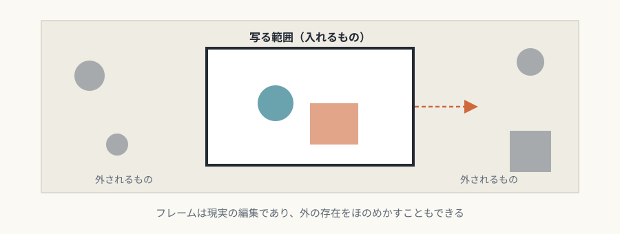
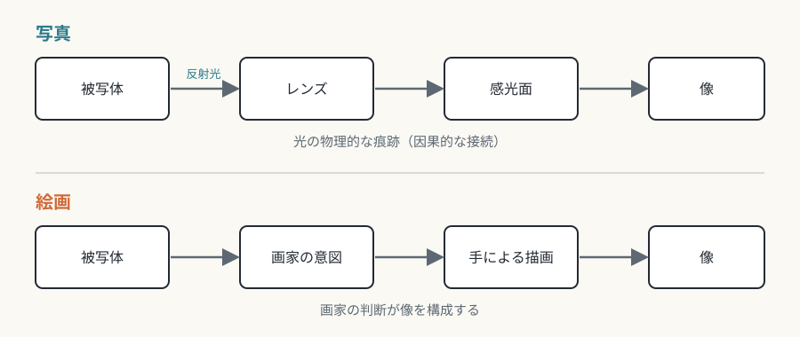

# 第8回　写真——光の痕跡と瞬間の切断

## インデックス性と瞬間の切断、そしてデジタルとAIによる揺らぎ

<!-- NAV:TOP -->
[← 第7回](07-cinema.md) | [連載目次](../README.md) | [第9回 →](09-comics.md)
<!-- /NAV -->

> 本回では、第8芸術と呼ばれることのある「写真・テレビ・ラジオ」のうち、写真を中心に扱います。テレビとラジオは、本連載の範囲には含めていません。

写真は、被写体から反射した光が感光面に届いた、その物理的な結果です。この因果的な結びつきが、写真を絵画から分けます。

## 媒体固有の条件

### インデックス性

写真像は、光学的・化学的な過程（現在は電子的な過程）による、現実の物理的な痕跡です。ロラン・バルトは、写真の本質（ノエマ）を「それはかつてあった」（ça a été）と呼びました。[^barthes-chambre-claire] 被写体との物理的な結びつきは、記号論ではインデックス（指標）性と呼ばれます。この物理的な接続が、写真の証拠能力と記録性を支え、報道、科学、法的な場面での信頼性の根拠になっています。

*図8-1：ニセフォール・ニエプス《ル・グラの窓からの眺め》（1826〜27年頃）。現存する最古の写真とされるヘリオグラフ。ハリー・ランサム・センター蔵のスキャン。出典：[Wikimedia Commons](https://commons.wikimedia.org/wiki/File:Untitled_%28point_de_vue%29,_Ni%C3%A9pce_1827_%E2%80%94_HRC_2020_%28cropped%29.jpg)、パブリックドメイン。*

### 決定的瞬間の切断

アンリ・カルティエ=ブレッソンの「決定的瞬間」は、流れる時間のなかから意味のある一瞬を選び取る、という撮影の考え方を言い表した語として知られています。[^cartier-bresson-images-a-la-sauvette] シャッター速度の選択は、動きのぶれを制御し、凍りついた時間と流れる時間を使い分けます。長時間露光は、肉眼では見えない時間の堆積を目に見えるものにし、写真に固有の時間表現を広げます。

*図8-2：ルイ・ダゲール《タンプル大通り》（1838年）。数分以上の露光のため、動く通行人や馬車は消え、動かないものだけが写る。出典：[Wikimedia Commons](https://commons.wikimedia.org/wiki/File:Boulevard_du_Temple_by_Daguerre.jpg)、パブリックドメイン。*

### 機械的な再現性

写真は、原理的には撮影者の身体の痕跡を像に残さず、その非人称性が、客観性の印象を生みます。ただし、フレーミング、露出、焦点の選択は主観的な決定です。機械的な客観性は、歴史的に作られた理想でもありました。[^daston-galison-objectivity] ピクトリアリズムは、意図的なぼかしや手作業のプリントで、絵画のような主観性を写真に持ち込もうとしました。

*図8-3：ガートルード・ケーゼビア《Blessed Art Thou Among Women》（1900年頃、フォトグラビュール）。ピクトリアリズムの作例で、やわらかい階調と輪郭が特徴。ナショナル・ギャラリー・オブ・アート蔵。出典：[Wikimedia Commons](https://commons.wikimedia.org/wiki/File:Gertrude_K%C3%A4sebier,_Blessed_Art_Thou_Among_Women,_c.1900,_NGA_150204.jpg)、CC0（同館のオープンアクセス）。*

## 固有の表現領域

### フレーミング

写真のフレームは、何を入れるかの決定であると同時に、何を排除するかの決定です。現実の編集行為にあたります。フレームの外の存在をほのめかす構図は、想像力を刺激します。スナップショットの美学は、フレーミングの偶然性を肯定し、計算された構図の代わりに即興性を価値としました。

*図8-4：フレーミング：何を入れ、何を外すか（本連載による概念図）。*

### 被写界深度と露出時間

浅い被写界深度は、主題を背景から分離し、ボケ（bokeh）という美的な効果を生みます。深い被写界深度は、画面全体に焦点を合わせ、手前から奥までを同じように見せます。これらは技術的な制約から出発して、美学の語彙として定着し、スマートフォンでも模倣されています。

### 瞬間の抽出

写真は、連続する現実から、離散的な瞬間を切り出し、その瞬間に永続性を与えます。写真の普及は、人が過去を思い出すときの像のあり方にも影響した、という見方があります。連続写真や連写は、瞬間の連なりを示し、映画とは別の仕方で、時間の流れを表現します。

## 他芸術との境界

### 絵画との違い

絵画は、画家の意図で構成されますが、写真は、原理的には、現実から自動的に転写されます。制作過程に因果的な接続（光の物理的な刻印）があるかどうかが、二つの違いです。この違いが、フォトモンタージュや合成写真での、操作や捏造という倫理的な問題を生みます。

*図8-5：写真と絵画：像ができるまでの因果の違い（本連載による概念図）。*

### デジタル加工とインデックス性の揺らぎ

デジタル写真は、光学的な像を数値データに変換し、後処理での際限のない改変を可能にしました。生成AIによる画像合成は、被写体の物理的な存在なしに、「写真的」な画像を作り、インデックス性を完全に失わせます。この変化は、写真の証拠能力と報道写真の信頼性に、根本的な疑問を投げかけています。

## まとめ

- 写真の核心は、光の痕跡というインデックス性と、時間の切断にある。
- フレーミング、被写界深度、露出時間が、写真の美学の語彙になる。
- デジタル加工と生成AIは、インデックス性を揺るがし、写真の媒体固有性の再考を迫っている。

第9回は漫画です。一枚の中に複数の時間を並べる、この独特の媒体の仕組みを、コマとクロージャーを手がかりに見ます。

## 参考文献・注記

[^barthes-chambre-claire]: ロラン・バルト『明るい部屋——写真についての覚書』（花輪光訳、みすず書房、1985年）。原著は *La Chambre claire: Note sur la photographie*（1980年）。英訳は *Camera Lucida*（リチャード・ハワード訳、Hill and Wang、1981年）。インデックス（指標）性という整理は、記号論の用語による本連載の説明である。
[^cartier-bresson-images-a-la-sauvette]: アンリ・カルティエ＝ブレッソン *Images à la sauvette*（Verve、1952年）。米国版は *The Decisive Moment*（Simon & Schuster、1952年）で、この英語題は米国の出版社が付けた。
[^daston-galison-objectivity]: ロレイン・ダストン、ピーター・ギャリソン *Objectivity*（Zone Books、2007年）。「機械的客観性」を、19世紀に形づくられた認識上の理想として論じている。

<!-- NAV:BOTTOM -->
---

[← 第7回](07-cinema.md) | [連載目次](../README.md) | [第9回 →](09-comics.md)
<!-- /NAV -->
