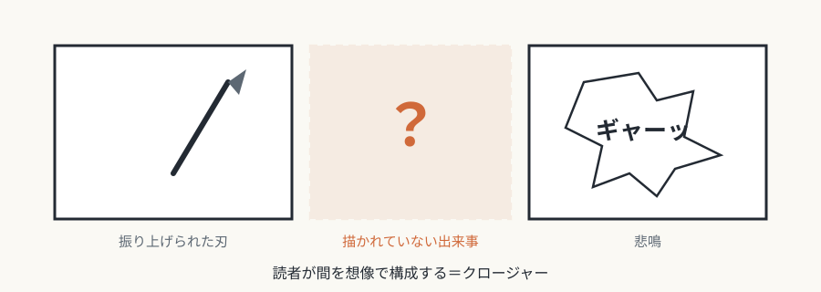
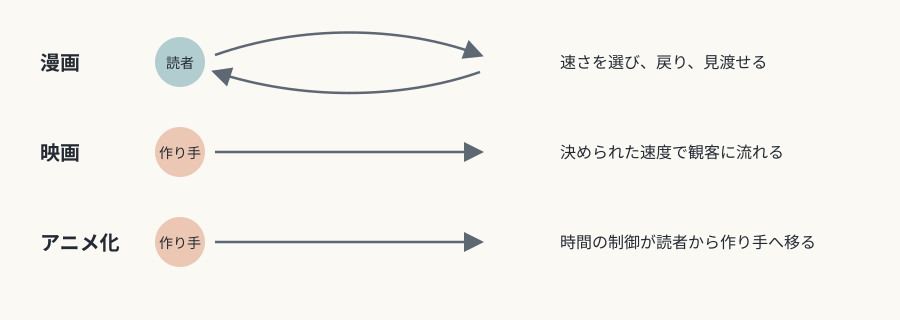

# 第9回　漫画——時間を空間に並べる

## コマによる時間の空間化と、読者のクロージャー

<!-- NAV:TOP -->
[← 第8回](08-photography.md) | [連載目次](../README.md) | [第10回 →](10-post-medium.md)
<!-- /NAV -->

フランス語圏でバンドデシネに与えられた「第9芸術」という呼び名は、漫画一般にも使われることがあります。[^ninth-art-label] この媒体は、映画とも絵画とも小説とも違う、独自の時間の扱い方を持っています。

## 媒体固有の条件

### 時間の空間化

漫画は、ページという二次元の平面の上に、複数の時間の瞬間を並べ、時間を空間として広げます。[^mccloud-time-frames] 映画は時間軸の上の連続、絵画は単一の瞬間です。漫画の時間表現は、どちらとも違います。見開きのページ全体を一望すると、過去・現在・未来が同時に視野に入る、という独特の時間経験が生まれます。

*図9-1：ロドルフ・テプフェール《ジャボ氏の物語》（1833年）。一つの頁にコマを並べ、文章とともに時間の経過を見せる。出典：[Wikimedia Commons](https://commons.wikimedia.org/wiki/File:Jabot_1833_p_27.jpg)、パブリックドメイン。*

### 言語と視覚イメージの不可分な統合

漫画では、絵と文字が補い合う関係にあり、どちらか一方だけでは物語が成り立ちません。吹き出しの中のセリフは、絵の中に空間的に配置され、視覚的な構成の一部として働きます。この統合は、絵本や挿絵つきの小説よりも密接で、漫画に固有の表現形式をつくります。

### クロージャー

スコット・マクラウドが漫画論の中心に据えたクロージャーは、コマとコマのあいだの空白を、読者が想像で埋める働きです。たとえば、振り上げられた刃を描いたコマの次に悲鳴を描けば、読者は、そのあいだの暴力行為を想像で組み立てます。[^mccloud-closure] 映画でもフレームのあいだの補完は起きますが、連続的で、ほとんど意識されません。漫画では、読者がコマのあいだを意識的に埋めます。クロージャーは、漫画を読者参加型の媒体にします。

*図9-2：コマとコマのあいだを読者が補う（クロージャー。本連載による概念図）。*

## 固有の表現領域

### コマ割りとページ構成

小さなコマの連続は、時間を細かく刻み、緊迫感やスローモーションの効果を生みます。大きなコマや見開きは、時間を止めて、重要な瞬間を視覚的に強調します。斜めのコマ、重なり、フレームの破壊といった変則的な配置は、動揺や混乱の感覚を視覚的に伝えます。

*図9-3：ウィンザー・マッケイ《リトル・ニモ》（1908年8月9日付）。11コマ目だけを大きくして、場面の転換を強調している。出典：[Wikimedia Commons](https://commons.wikimedia.org/wiki/File:Little_Nemo_1908-08-09.jpg)、パブリックドメイン。*

### 記号の体系

吹き出しの形（ギザギザ、雲形、破線）は、発話のトーンや種類（叫び、思考、ささやき）を見えるものにします。オノマトペは、音響を視覚記号に変換し、文字の形や配置で、音の質を表現します。効果線（スピード線、集中線）は、運動、感情、注意を視覚的に強調する、漫画に固有の約束事です。

### 静止画での運動と時間経過の表現

残像表現、複数の身体位置の重ね描き、運動のぶれ線は、静止画で動きを示す技法です。一つのコマの中に複数の時間（背景で進む別の行動など）を描くことで、同時性も表現できます。これらの技法は、数十年にわたる実験の蓄積で洗練されてきました。

## 他芸術との境界

### 映画との違い

映画の観客は、24fpsなどの速度を受け入れるしかありません。漫画の読者は、読む速度を自由に調節でき、戻って読み返し、細部を見つめ、ページ全体を見渡すことも簡単です。この読者の能動性が、漫画の複雑な物語構造や、細かい描き込みを可能にしています。

### 絵本との違い

絵本は通常、1ページ（または見開き）に1つの場面を描き、時間はページをめくることで進みます。漫画は、1ページの中に複数の時間の瞬間を置くので、より細かい時間の分節と連続を表現できます。

### アニメ化

漫画をアニメにすると、時間を制御する主体が読者から作り手に移ります。読者の時間制御は失われ、時間の経過は制作者がすべて決めます。同時に、静止画のあいまいさ（運動の途中の状態を想像すること）は、実際の運動に置き換えられて、一つの意味に定まります。原作の漫画とアニメ化された作品が、別の体験を与えるのは、この媒体固有性の違いによります。

*図9-4：時間の進み方を決めるのは誰か：漫画、映画、アニメ化（本連載による概念図）。*

## まとめ

- 漫画の核は、コマによる時間の空間化、言語と絵の統合、読者のクロージャーにある。
- コマ割り、記号の体系、静止画での運動表現が、固有の表現領域をつくる。
- 読者が時間進行を制御できることが、映画やアニメとの決定的な違いになる。

最終回の第10回では、デジタル技術で媒体の境界が溶けた現代に、媒体固有性の理論がどこまで有効なのかを考えます。

## 参考文献・注記

[^ninth-art-label]: 「第9芸術」という呼称は、1960年代のフランス語圏で定着したとされる。クロード・ベイリーが1964年にバンドデシネを「第9芸術」と呼び、のちにフランシス・ラカッサン『Pour un neuvième art : la bande dessinée』（Union générale d'éditions、1971年）が広めたとされる。
[^mccloud-time-frames]: スコット・マクラウド *Understanding Comics: The Invisible Art* の第4章 "Time Frames" に、漫画では時間と空間が同じものだという趣旨の記述がある。書誌は次の注を参照。
[^mccloud-closure]: スコット・マクラウド *Understanding Comics: The Invisible Art*（Tundra Publishing、1993年。Kitchen Sink Press 版もある）。邦訳は、椎名ゆかり訳・小田切博監修『マンガ学——マンガによるマンガのためのマンガ理論 完全新訳版』（復刊ドットコム、2020年）。本文の例は、同書第3章（"Blood in the Gutter"）の、振り上げられた斧の例に基づく。映画とのクロージャーの違いの整理も、同章の趣旨による。

<!-- NAV:BOTTOM -->
---

[← 第8回](08-photography.md) | [連載目次](../README.md) | [第10回 →](10-post-medium.md)
<!-- /NAV -->
