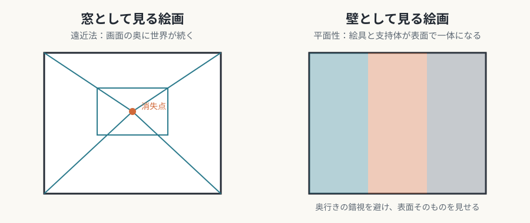

# 編集・保守ガイド

[連載目次へ](../README.md)

## 原本と生成物の責務

| パス | 責務 | 編集方法 |
| --- | --- | --- |
| `chapters/*.md` | 各回の本文と前後リンク | 直接編集する |
| `series.json` | 回の順序、題名、副題、要約、部（`parts`）、関連する連載へのリンク | 本文変更と同じPRで整合させる |
| `README.md` | 連載の概要と目次。マーカーより前が閲覧版のトップページになる | 回の追加・改題のたびに更新する |
| `assets/illustrations/*.svg` | 本連載が作る概念図 | 直接編集する |
| `site-src/styles.css` | HTML閲覧用の見た目 | 本文内容を持たせない |
| `scripts/build.py` | MarkdownをHTMLへ変換 | 原本を改変しない |
| `scripts/validate.py` | 本文・リンクの構造検査 | 検査規則を保守する |
| `scripts/check_html.py` | HTMLの相対リンク・アンカー・外部依存を検査 | 生成後に実行する |
| `scripts/check_external.py` | 外部画像の到達確認（ネットワークが必要） | 随時、手動で実行する |
| `tests/` | 検査・変換の回帰試験 | 成功例と失敗例を両方持つ |
| `_site/` | ブラウザ用生成物 | 直接編集せず再生成する |

## 変更の最小手順

```sh
# Markdown を編集した後
python scripts/validate.py
python -m unittest discover -s tests -v
python scripts/build.py
python scripts/check_html.py
```

## 各回の型

各回の冒頭は `# 第N回　題名`、その直下に一行の主題を `## 副題` として置く。`series.json` の `title` と `subtitle` と一致していることを検査が確かめる。続けて `<!-- NAV:TOP -->` で囲んだ前後リンク、本文、`<!-- NAV:BOTTOM -->` で囲んだ前後リンクの順に並べる。末尾のナビには次回の題名がビルド時に添えられるので、本文に「次回予告」のラベルは置かない。次回へのつなぎは、結びの一段落に書く。

本文は、導入、各芸術の三つの視点（媒体固有の条件・固有の表現領域・他芸術との境界）、「まとめ」の順で書く。節見出しは `##`、その下の小見出しは `###` とする。紹介した理論と、本連載の解釈は、本文中で区別して書く。

## 回の追加・並べ替え

1. `chapters/NN-slug.md` を作り、`series.json` の `chapters` に番号・slug・題名・副題・要約・パスを追加する。
2. `parts` が1〜N回をもれなく順に覆うように直す。
3. READMEの目次表と、前後の回の `NAV` 行を更新する。
4. `python scripts/validate.py` を通す。

## 出典の書き方

出典は脚注で示す。第3回が見本である。

- 本文の該当箇所の直後に `[^id]` を置く。`id` は `著者-書名` のような英小文字とハイフンにする。
- 回の末尾（前後ナビの直前）に `## 参考文献・注記` を置き、その下に `[^id]: 書誌` を並べる。ビルドは、脚注の一覧を「参考文献・注記」の直後、末尾のナビの前へ移す。
- `series.json` の該当回の `sources` に、脚注の `id` を列挙する。本文の脚注・定義・`sources` の三つが一致していることを検査が確かめる。脚注のない回は `sources` を省略してよい。
- 書誌は、出版社・刊行年などを確認できたものだけを書く。邦訳は、確認できたときだけ添える。確認できないものは載せず、本文を弱めるか削る。
- 発言の引用は、原典を確認できないものを断定で書かない。本文が連載の解釈であるときは、脚注にそう書く。

## 図の置き方

図は、その内容を説明し終えた段落の直後に置く。

```markdown


*図3-1：説明。*
```

- キャプションは `*図N-k：…*` とし、`k` は回内の通し番号にする。画像の数と順序に一致することを検査が確かめる。
- 本連載が作る概念図は `assets/illustrations/NN-x-slug.svg`（回番号と枝番）に置く。`viewBox`、`role="img"`、`title`、`desc` を持たせる。`script`、外部画像、外部フォント、イベントハンドラは入れない。
- 作品の画像は、パブリックドメインのものに限り、Wikimedia Commons へ直接リンクする。URL は `https://commons.wikimedia.org/wiki/Special:FilePath/ファイル名?width=800` の形にする（ファイル名はURLエンコードする）。画像はリポジトリに置かない。
- 外部画像のキャプションには、作品名・制作年・出典（Commons のファイルページへのリンク）・ライセンスを書く。ファイルページへのリンクがないと検査が失敗する。
- 画像を載せる前に、Commons のファイルページで、ライセンスがパブリックドメインであること、作者の没年と制作年が日本の保護期間（死後70年）を過ぎていることを確認する。
- 許可する外部画像のホストは `scripts/build.py` の `EXTERNAL_IMAGE_HOSTS` で決める。
- 外部画像のリンク切れは、`python scripts/check_external.py` で確認する（ネットワークが必要。CIには含めない）。

## 公開前の目視確認

GitHubのPreview、HTMLのデスクトップ幅とスマートフォン幅で確認する。ページ全体の横はみ出しや欠けた日本語は修正する。
